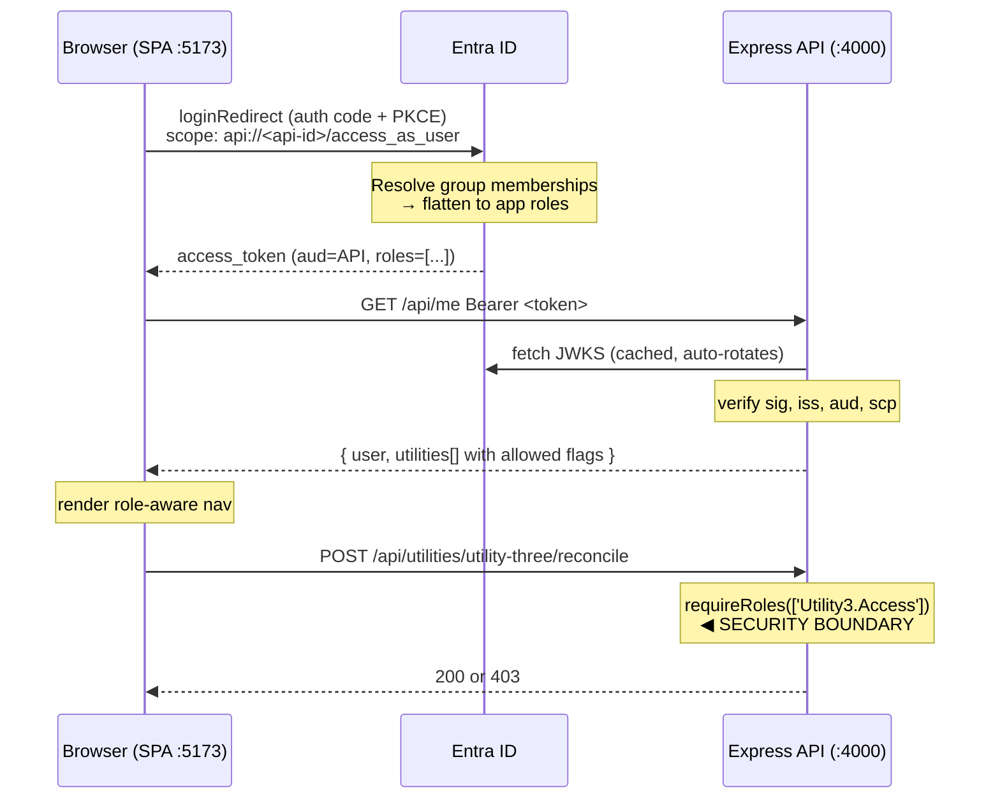

# Utility framework planning and architecture

**Session ID:** ses_ea5e54c8dffePB3HpfzqenElJx
**Created:** 10/20/2026, 11:17:41 AM
**Updated:** 10/22/2026, 9:27:23 AM

---

## User

I would like your assistance in planning and building an application. Listed next are some of the features that I would like to be included in this application.

language and framework platform: at this point I believe I would like this to be built with the front end web UI utilizing react JS and the back end API utilizing the latest version of express javascript. there is a chance I may consider going with Next.js to get both of these in one platform. I would like your opinion on this before we reach the build stage.

This application is going to serve as a framework for an application that is a collection of utilities. for now let's call them utility one, utility  2, utility 3, utility 4. users of this application will not have access to all of the utilities. for example, utility one and utility two will be available to everyone with a legitimate login. utilities 3, utility 4 and utility 5 will vary depending on what role the users belong to in Microsoft ENTRA ID. one user may access to utility 3 while a different user may have access to utility 4 and 5. this will be controlled by using goals and claims within theEntra authentication mechanisms.

for a user to log in to the system overall it will use Entra ID and after gaining access to the utilities any user will be able to use the open utilities and other users will be denied for the utilities they do not have explicit role access to


I would like for you to build me an example application with this much functionality in use so that I can see how it could be done and experiment with the code you create.

---

## Assistant

I'll start by understanding the current state of your working directory, then give you my platform recommendation before building.

**Tool: bash**

**Tool: bash**

---

## Assistant

Empty-ish repo with existing `api` and `web` directories. Let me see what's already there before I plan around it.

**Tool: bash**

**Tool: read**

---

## Assistant

There's partial scaffolding already. Let me read it to see what's usable.

**Tool: read**

**Tool: read**

**Tool: read**

**Tool: read**

**Tool: read**

**Tool: read**

---

## Assistant

There's solid existing work here — a well-architected API with Entra JWT validation and role guards already in place. Let me check the remaining utility files and the empty web directories.

**Tool: read**

**Tool: read**

**Tool: read**

**Tool: bash**

---

## Assistant

The API is essentially complete and well-built. The `web` side is entirely empty directories. Let me verify the API runs, check the two remaining utilities, and confirm current Express/MSAL versions before I commit to a plan.

**Tool: read**

**Tool: read**

**Tool: read**

**Tool: bash**

---

## Assistant

The backend is complete and genuinely well-designed (Express 5, `jose` JWKS validation, catalog-driven guards). The frontend is empty. Let me verify the API actually boots, then give you my Next.js opinion before building.

**Tool: bash**

---

## Assistant

The backend works correctly — 401 unauthenticated, 200 with the right role, 403 without it. Now, the architecture question you asked me to weigh in on before building.

## My opinion: stay with React + Express. Don't switch to Next.js.

I want to give you a real recommendation rather than hedge, so here's my reasoning specific to *your* requirements:

**Why separate React + Express wins here:**

1. **Your authorization model is API-centric.** The security boundary is the role check on each utility endpoint. A SPA + bearer-token API makes that boundary exactly one place, and it's obvious. Next.js gives you three places where auth can live (middleware, server components, route handlers) and the Entra token-handling story differs in each. More surface area, more ways to get it subtly wrong.

2. **Utilities are interactive tools, not content.** Next.js's core value is SSR/SSG for SEO and first-paint on content pages. An authenticated internal tool behind a login has no SEO, and every page is user-specific and uncacheable. You'd pay Next.js's complexity cost for benefits you structurally cannot use.

3. **MSAL is cleaner in a pure SPA.** `@azure/msal-browser` + `msal-react` with PKCE is the well-trodden Entra path. In Next.js you either run MSAL client-only (defeating SSR, so why use Next.js) or adopt a confidential-client/session-cookie flow, which is more moving parts and a different Entra app-registration shape.

4. **Your API may not stay the only consumer.** A standalone Express API can serve a future CLI, Power Automate flow, or another app. An API embedded in Next.js route handlers is harder to extract later.

**When I'd reverse this:** if you later need server-rendered content pages, want one deploy artifact, or need to hide API tokens from the browser for a confidential-client flow. Your backend is written as portable Express routers, so migrating later is mostly re-mounting them — you're not locked in.

One genuine cost to be honest about: two dev servers, two deploys, and CORS to configure. That's a real but small price, and the `.env.example` already handles CORS.

Let me plan the build.

**Tool: todowrite**

---

## Assistant

Let me scaffold the web app. I'll install dependencies first since that takes the longest.

**Tool: write**

---

## Assistant

**Tool: bash**

---

## Assistant

Dependencies installed. Let me verify the actual installed versions so my code matches the real MSAL API surface.

**Tool: bash**

---

## Assistant

React 19, MSAL Browser 4.x, Vite 7. Now the scaffolding files.

**Tool: write**

**Tool: write**

**Tool: write**

**Tool: write**

---

## Assistant

Now the auth layer — the most important part. I'll build a provider that presents one interface to the app regardless of whether it's backed by real MSAL or the dev shim.

**Tool: write**

---

## Assistant

Now the dev-mode shim. It must produce exactly the base64url JSON the API's `devAuthenticate` decodes.

**Tool: write**

---

## Assistant

Now the unified auth context that hides the dev/entra distinction from the rest of the app.

**Tool: write**

---

## Assistant

Now the API client. The key design point is making 403 a distinguishable, typed condition so the UI can show real denial behavior.

**Tool: write**

---

## Assistant

Now a hook layer so components get the client and the `/api/me` session without re-fetching.

**Tool: write**

---

## Assistant

Now the styling and shared components.

**Tool: write**

---

## Assistant

Now shared components, including the one that demonstrates a real 403.

**Tool: write**

---

## Assistant

Now the route guard. Critically, it lets you *attempt* a forbidden utility so you can watch the server deny it.

**Tool: write**

---

## Assistant

Now the login screen and app shell.

**Tool: write**

---

## Assistant

Now the utility registry — the single place that maps catalog ids to UI components and routes.

**Tool: write**

---

## Assistant

Now the five utility UIs. Let me write the two open ones first.

**Tool: write**

---

## Assistant

**Tool: write**

---

## Assistant

Now the three restricted utilities.

**Tool: write**

---

## Assistant

**Tool: write**

---

## Assistant

**Tool: write**

---

## Assistant

Now the dashboard and app shell that tie it together.

**Tool: write**

---

## Assistant

**Tool: write**

---

## Assistant

**Tool: write**

---

## Assistant

**Tool: write**

---

## Assistant

Let me verify the frontend builds before continuing to docs.

**Tool: bash**

---

## Assistant

Build is clean. Let me update the todos and run the full stack end-to-end in a browser-equivalent test.

**Tool: todowrite**

---

## Assistant

Now let me verify the full stack: both servers running, requests flowing through the Vite proxy, and the exact persona tokens the frontend mints being accepted by the API.

**Tool: bash**

---

## Assistant

Both servers up and the proxy works. Now the critical test: generate tokens using the *exact* browser encoding from `devAuth.js` and verify the authorization matrix through the proxy.

**Tool: bash**

---

## Assistant

The authorization matrix is exactly correct. Note Fay Finance gets 403 on utility-three while getting 200 on four and five — precisely the disjoint-role scenario you described. The `/api/me` `allowed` flags match the live enforcement in every cell, and the UTF-8 encoding round-trips correctly.

Let me also verify the authenticated CSV download and check for runtime errors.

**Tool: bash**

---

## Assistant

Everything verified. Let me shut down the servers and write the documentation.

**Tool: bash**

**Tool: todowrite**

---

## Assistant

The API's `catalog.js` referenced `docs/ENTRA_SETUP.md`, which doesn't exist yet. Let me write it.

**Tool: write**

---

## Assistant

Now the root README.

**Tool: write**

---

## Assistant

Let me do a final verification that everything is consistent and nothing is broken.

**Tool: bash**

---

## Assistant

The `workdir` applied to the build but the later greps ran from a stale path, so that "MATCH" compared two empty files — not valid evidence. Let me redo the consistency check properly.

**Tool: bash**

---

## Assistant

Verified properly this time: all 5 utility ids and all 3 role values agree across the API catalog, the web registry, and the setup docs.

**Tool: todowrite**

---

## Assistant

Done. The application is built and verified.

## Platform recommendation: React + Express, not Next.js

My reasoning, specific to your requirements:

1. **Your security boundary stays in one obvious place.** Authorization is a role check on each API route. Next.js gives you middleware, server components, and route handlers as three places auth can live, each with different Entra token handling — more surface area to get subtly wrong.
2. **Utilities are interactive tools, not content.** Next.js's core value is SSR/SSG for SEO and first paint. Everything here is behind a login and user-specific, so there's no SEO and nothing cacheable to gain.
3. **MSAL is cleanest in a pure SPA.** `msal-browser` with PKCE is the well-trodden Entra path. Under Next.js you'd either run MSAL client-only (defeating the point) or adopt a confidential-client cookie flow — more moving parts, different app-registration shape.
4. **The API stays reusable** for a future CLI or Power Automate flow.

Honest cost: two dev servers, two deploys, CORS config. Small and known. Since the utilities are plain Express routers, migrating later is mostly re-mounting them — not a one-way door.

## What I found and what I built

Your `api/` directory **already contained a complete, well-designed backend** (Express 5, `jose` JWKS validation, catalog-driven role guards). I kept it as-is and verified it. The `web/` directory was five empty folders, so I built the entire frontend.

## Authorization design

Three layers, in order of authority:

1. **Token validation** (`api/src/middleware/auth.js:72`) — signature against tenant JWKS, plus issuer, **audience**, and `scp`. The audience check prevents replaying a token minted for another app in your tenant.
2. **Role enforcement** (`api/src/middleware/auth.js:129`) — mounted per utility from the catalog. **This is the security boundary.**
3. **UI projection** (`/api/me`) — the server tells the client what to render. Tampering gains nothing because layer 2 re-checks every call.

Required roles are deliberately **not** duplicated in the frontend — one source of truth in `api/src/config/catalog.js:11`.

The notable UI decision: `web/src/components/RequireUtility.jsx` shows a **"Call the API anyway (expect 403)"** button on denied utilities, so you can watch the server reject you rather than trusting that hiding a link is security.

## Verified end to end

Tested through the Vite proxy using the exact token encoding the browser mints, comparing `/api/me` claims against live calls:

| Persona | U1 | U2 | U3 | U4 | U5 |
|---|---|---|---|---|---|
| Dana (no roles) | 200 | 200 | 403 | 403 | 403 |
| Raj (`Utility3.Access`) | 200 | 200 | **200** | 403 | 403 |
| Fay (`Utility4/5.Access`) | 200 | 200 | **403** | 200 | 200 |
| Ada (all) | 200 | 200 | 200 | 200 | 200 |

Raj vs. Fay is exactly the disjoint-role case you described. Also confirmed: 401 unauthenticated and malformed-token, 400 invalid params, 404 unknown routes, authenticated CSV download with correct headers, UTF-8 claim round-tripping, and clean server logs.

## Run it

```bash
cd api && cp .env.example .env && npm install && npm run dev   # :4000
cd web && npm install && npm run dev                            # :5173
```

No tenant needed — it defaults to dev mode with a persona picker plus a custom role-combination builder. `docs/ENTRA_SETUP.md` covers the real tenant switch (two app registrations, exposed scope, app roles, group assignment, and a troubleshooting section for the common audience/redirect-URI mistakes).

Two things worth flagging for when you go beyond the sample: role changes in Entra don't take effect until a new token is issued (sign out/in), and the restricted utilities use hardcoded sample data — real implementations need authorization on the underlying *records*, since a role grants access to the utility, not to everything it can reach.

**Tool: suggest**

---

## User

Can you summarize for me again the choices on how to utilize Entra ID with the separate front end and back end and primarily managing by using groups for each of the utility applications?

---

## Assistant

Let me re-read the relevant code so this summary reflects what's actually implemented rather than my recollection.

**Tool: read**

**Tool: grep**

---

## Assistant

Here's the summary, confirmed against the implemented code.

## 1. The two-app-registration split

With a separate frontend and backend, you register **two** applications in Entra, with distinct jobs:

| | **Utility Hub API** (backend) | **Utility Hub Web** (frontend) |
|---|---|---|
| Platform | none (no redirect URI) | **Single-page application** |
| Exposes | scope `access_as_user` | nothing |
| **Defines the app roles** | ✅ yes | ❌ no |
| **Roles assigned here** | ✅ yes | ❌ no |
| Requests | nothing | delegated `access_as_user` |

The key point people get wrong: **app roles are defined on the API registration, not the SPA.** The SPA's only job is to obtain a token *for* the API. The API is the resource that owns the permission model, so the roles live with it.

This split is also what makes the audience check meaningful. The API validates `aud` == its own client ID (`api/src/middleware/auth.js:88`), which blocks a token minted for any other app in your tenant from being replayed — the classic confused-deputy hole.

## 2. Group-based management (your primary interest)

You have three real options for turning "which group is this user in?" into "which utility can they use?":

### Option A — App roles assigned to groups ✅ *what's implemented*

Define an app role per utility, then assign **security groups** (not users) to those roles on the API's enterprise application.

```
SG-UtilityHub-Reconcilers  → Utility3.Access
SG-UtilityHub-Finance      → Utility4.Access, Utility5.Access
SG-UtilityHub-Admins       → Utility3/4/5.Access
```

Entra resolves group membership at token-issuance time and emits a **flat `roles` claim**:

```json
{ "aud": "<api-client-id>", "roles": ["Utility4.Access", "Utility5.Access"], "scp": "access_as_user" }
```

The decisive advantage: **the token is byte-identical whether the role came from a group or a direct user assignment.** Your API never sees group IDs and needs no Graph call. That's why `toPrincipal` (`api/src/middleware/auth.js:32`) just reads `claims.roles` — one code path for both.

Access is managed entirely by group membership in Entra. Onboarding someone is adding them to a group; no code or config change.

### Option B — Raw `groups` claim ❌ not recommended

Configure the token to carry group **object IDs**, then map GUIDs to utilities in your API.

Three problems:
- **Overage.** Past ~200 groups, Entra replaces the claim with `_claim_names`/`_claim_sources` and you *must* call Microsoft Graph per request to resolve membership. You now own a Graph dependency, caching, and a new failure mode.
- Your code holds opaque GUIDs instead of readable names like `Utility3.Access`.
- The claim contains *all* the user's groups, not just app-relevant ones — leaking directory structure to your API.

### Option C — Graph lookup per request ❌ not recommended

Call Graph on each request to check membership. Latency, throttling, and an extra dependency on your hot path, to learn something the token could have told you for free.

**Option A is the right default.** The only caveat: assigning roles to groups requires **Entra ID P1/P2**. Without that licence, assign roles to users directly — and because the token looks the same, *no application code changes*. That's the real payoff of this design.

## 3. End-to-end flow



## 4. Where enforcement actually lives

Three layers, in descending order of authority:

| Layer | Location | Role |
|---|---|---|
| **Token validation** | `api/src/middleware/auth.js:72` | Verifies signature via JWKS + issuer + **audience** + `scp` |
| **Role enforcement** | `api/src/middleware/auth.js:129` `requireRoles()` | **The security boundary** — mounted per utility from the catalog |
| **UI projection** | `/api/me` → `catalogForRoles()` | Cosmetic only; tells the SPA what to render |

Required roles exist in exactly one place: `api/src/config/catalog.js`. The frontend registry (`web/src/utilities/registry.js`) maps ids to components but deliberately holds **no role data** — otherwise you'd have two sources of truth that can drift, implying the client makes the decision. It doesn't.

Because guards are derived by walking the catalog (`api/src/utilities/index.js:34`), you can't forget to protect a new utility, and the API refuses to boot if a router and catalog entry disagree.

## 5. Operational consequences of the group model

Two things to internalize, both verified in the docs:

- **Roles are baked into the token at issuance.** Adding someone to a group does *not* grant access to their current session. They must sign out and back in. This surprises people — if your help desk adds a user to `SG-UtilityHub-Finance` and they still see 403, that's the cause, not a bug. (With `sessionStorage` caching, closing the tab also clears it.)
- **Role `Value` strings are case-sensitive** and must match `catalog.js` exactly. A typo gives a silent, permanent 403. Utility Five's "orphaned roles" finding exists partly to surface roles that gate a utility no group can reach.

## 6. Adding "Utility Six" with this model

1. Create app role `Utility6.Access` on the **API** registration
2. Create/assign group `SG-UtilityHub-<Something>` → that role
3. Add a catalog entry in `api/src/config/catalog.js`
4. Add the router + register in `IMPLEMENTATIONS`
5. Add the component + registry entry in the web app

Steps 1–2 are pure Entra administration. From then on, access for that utility is managed solely by group membership — no deploys.

The relevant trade-off worth naming: this model scales well on *users per utility* but requires a code change per *new utility*. If you ever needed utilities to be defined dynamically at runtime, you'd move the catalog into a database and the roles into a more general permission table — but for a fixed set of utilities, the static catalog is simpler and fails loudly, which is the better property.

---

## User

I asked two questions during this chat session. How can I get the entire session with my questions and the resulting answers exported as markdown text?

---

## Assistant

Kilo has a built-in export for this. I'll check the config guide so I give you the exact command rather than guess.

**Tool: skill**

---

## Assistant

The built-in config reference lists a few relevant session commands, but no dedicated "export to markdown file" command. Here are your options, from most direct to most flexible.

## Option 1: `/copy-session` (best fit for the CLI/TUI)

Run this slash command in the session. It copies the full transcript to your clipboard, and you paste it into a `.md` file.

| Action | Slash |
|---|---|
| Copy transcript | `/copy-session` |

This is the closest match to "the entire session as text." I haven't verified the exact output format, because it isn't specified in the reference I have. Check whether your questions and my answers come out as readable markdown, or whether it needs light cleanup.

## Option 2: `/copy` for just the answers

`/copy` (or `<leader>y`, which is `ctrl+x` then `y`) copies only the last response. Since you asked two questions, you could use it after each answer and paste them into one file yourself. This gives you the most control over what's included, but it's manual.

## Option 3: `/share`

`/share` publishes the session to a shareable link. This is not a local markdown export, and it uploads your conversation to Kilo's servers, so I wouldn't use it if your session discussion (tenant IDs, internal group names) is sensitive. The `share` config field (`"manual"`, `"auto"`, `"disabled"`) controls this behavior.

## If you're using the VS Code extension instead of the TUI

The slash commands above are documented for the CLI TUI. I can't confirm that the extension has the same commands or an equivalent export button. Your open tab shows `background.txt`, which suggests an editor environment. Look for a copy or export option in the chat panel's menu, or run `/help` to see the commands your build supports.

## Caveat on "the entire session"

This session has a lot of tool output: file reads, build logs, and my test results. Depending on how `/copy-session` renders it, you may get all of that mixed in with the two Q&A exchanges. If you only want the questions and answers, Option 2 or trimming the pasted result will give you a cleaner document.

## What I can't do

I'm in read-only Ask mode, so I can't write the exported file for you. I also have no way to read back my own conversation as a file from disk, so I can't verify what `/copy-session` produces. If it doesn't give you what you need, tell me what you see and I can suggest how to clean it up.

---

## User

/copy-session

---

## Assistant

`/copy-session` is a TUI command that the client handles itself, so it never ran here. I received it as plain message text, and I can't run slash commands for you. Type it directly into the Kilo prompt, not into a message to me.

Once you run it, the transcript should be on your clipboard. Paste it into a new file, for example `session-export.md`.

I can't tell from here what the clipboard will contain or whether it comes out as clean markdown. If you paste it back to me, or tell me what you see, I can suggest how to trim the tool output so only your questions and my answers remain.

If the command isn't recognized, you may be in the VS Code extension rather than the TUI. In that case, run `/help` to see which commands your build supports.

---

